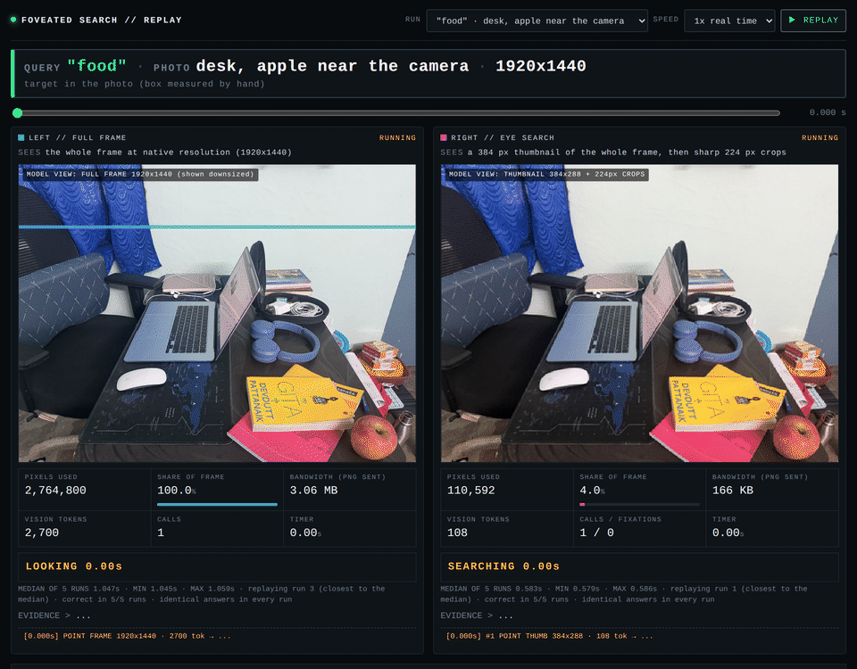
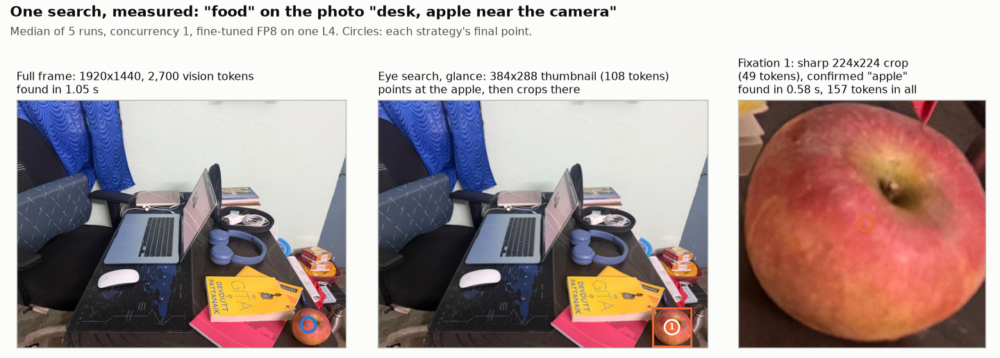
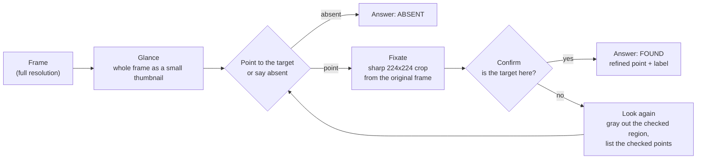
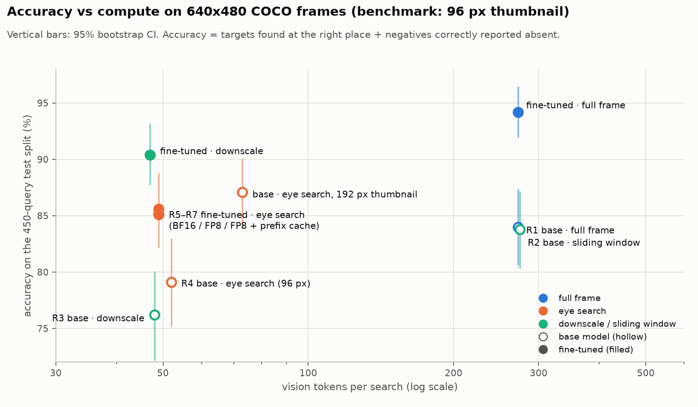
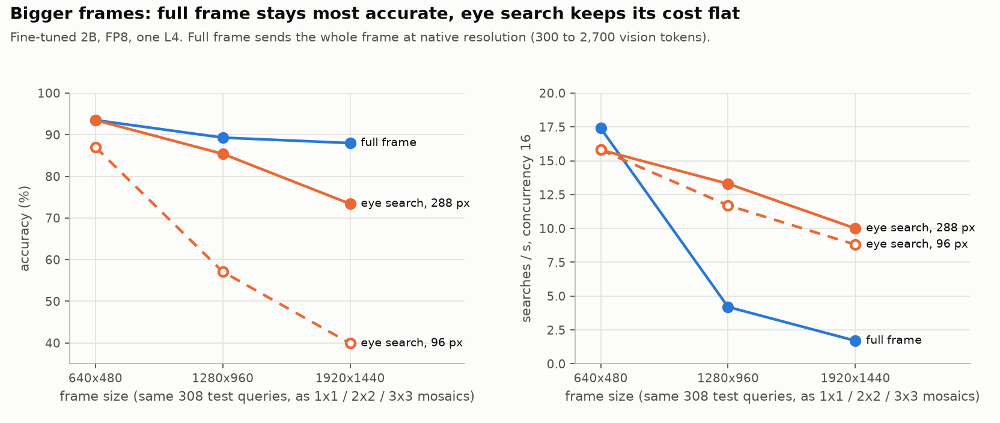
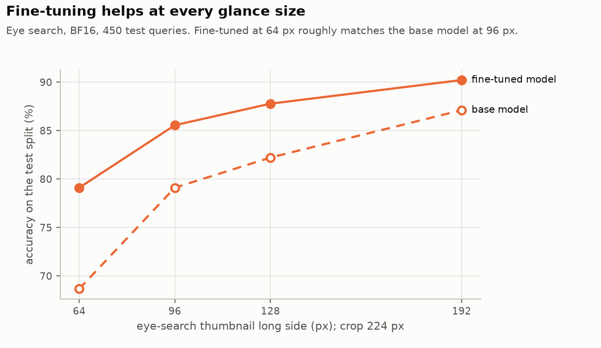
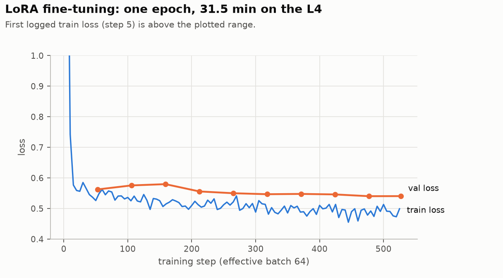
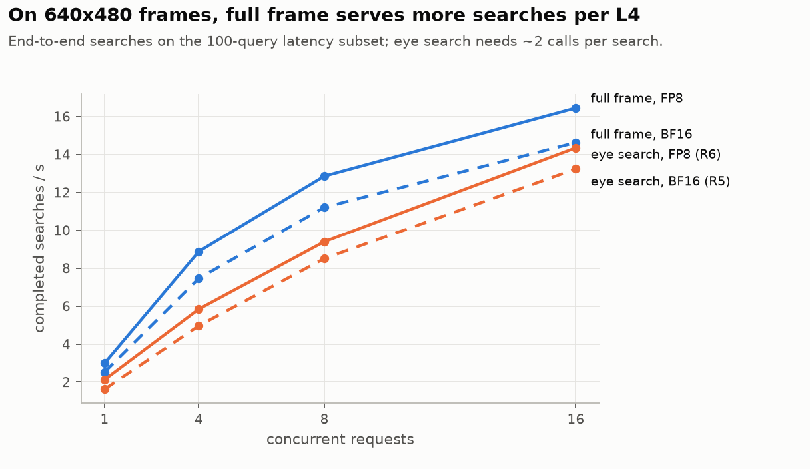

<!-- Generated by `make readme-tables` from scripts/readme_template.md and results/. Do not edit README.md by hand. -->
# foveated-vlm-search

**You type what you're looking for (say, "food"), and a small vision model finds it in a high-resolution camera frame, or tells you it isn't there, while looking at about 6% of the pixels.**

Vision models usually encode every pixel of every frame, and with high-resolution cameras that is the expensive part: more pixels, more compute, more data to move. This project makes the model search the way an eye does: glance at a small thumbnail of the whole scene, look closely at one spot, and stop as soon as it is sure.

<p align="center"></p>

<p align="center"><b>Query: "food"</b> on the photo "desk, apple near the camera" (1920x1440).<br>
<b>Left: full frame</b>, the model sees the whole photo (2,700 vision tokens).
<b>Right: eye search</b>, a 384 px thumbnail plus one 224 px crop (157 vision tokens).<br>
Then <b>query "apple"</b> on the same desk with the apple removed ("desk, no apple").<br>
<i>Vision tokens are the image pieces the model has to process; fewer means less compute.</i><br>
<b><a href="https://keerthanareddy17.github.io/foveated-vlm-search/">Try the interactive replay</a></b> · <a href="docs/assets/demo.mp4">MP4 version</a> · real measured traces, played back at real time</p>

Inspired by Gizdov, Ullman and Harari, *Seeing More with Less: Human-like Representations in Vision Models* (CVPR 2025).

**What I built**

- **A frozen benchmark:** 500 text queries on COCO photos (80 object categories plus "food"; for 100 of them the target is not in the photo).
- **The eye-search loop and three baselines** (full frame, sliding window, uniform downscale), all measured the same way: pixels, vision tokens, time, right or wrong.
- **Fine-tuning that teaches the model how to search**, not what food looks like: where to look in a tiny thumbnail, how to look again after a wrong guess, and how to confirm on a sharp crop, across all 80 COCO object categories plus "food" (35,497 generated examples, LoRA).
- **FP8 quantization** for the NVIDIA L4's native FP8 path.

**Results**

- **On a high-resolution photo, eye search answers in about half the time with a fraction of the work** (0.58 s vs 1.05 s, 17.2x fewer vision tokens, 13.3x less image data). When the apple is gone it says "absent" in 0.14 s, while full frame claims an apple and points at the Apple-logo mouse (8/8 vs 7/8 correct over the 8 desk queries).
- **On big frames, one GPU handles several times more searches** (3.2x at 1280x960, 5.9x at 1920x1440), because eye search's cost barely grows with the frame.
- **Fine-tuning taught the search, and FP8 made it faster for free** (eye-search accuracy 79.1% → 85.6%, +6.4 percentage points, 95% CI [+3.1, +10.0], with about 1.1% false alarms; FP8 24% faster, accuracy change -0.4 percentage points, 95% CI [-2.0, +1.1]).
- **Looking at the whole frame is still more accurate.** Eye search wins on cost, on speed for big frames, and on false alarms, not on raw accuracy (full frame vs eye search: 94.2% vs 85.6% on COCO photos and 88.0% vs 73.4% on 1920x1440 mosaics; false alarms on those mosaics 10.0% vs 4.3%).

## Example: what one search looks like

Query **"food"** on the photo "desk, apple near the camera" (1920x1440), the run shown in the replay:

1. **Glance.** The whole photo is shrunk to a 384x288 thumbnail (108 vision tokens, 166 KB) and the model is asked to point at the food or say there is none. It answers `{"point_2d": [891, 918]}` in 239 ms (coordinates on a 0-1000 scale), a spot on the apple at (1711, 1322) in the full photo.
2. **Look closely.** A sharp 224x224 crop is cut from the original photo around that spot, (1599, 1210)-(1823, 1434).
3. **Confirm.** The model sees only the crop (49 vision tokens) and answers `{"y": true, "point_2d": [516, 498], "l": "apple"}` in 344 ms: yes, it is an apple, with a refined point at (1715, 1322).
4. **Answer:** found in 0.58 s, using 157 vision tokens and 5.8% of the photo's pixels. Full frame needed 2,700 vision tokens and 1.05 s for the same answer.

<picture><source media="(prefers-color-scheme: dark)" srcset="docs/assets/trace_positive2_food_dark.png"></picture>

## Contents

[Example](#example-what-one-search-looks-like) · [How it works](#how-it-works) · [Results](#results) · [What worked and what didn't](#what-worked-and-what-didnt) · [Limitations](#limitations) · [What I'd do next](#what-id-do-next) · [Reproduce](#reproduce) · [Repository layout](#repository-layout) · [References](#references) · [License](#license)

## How it works



Eye search sends the whole frame once as a small thumbnail (96 px long side in the benchmark, 384 px in the photo demo) and asks the model to point at the target or say it is absent. It then cuts a sharp 224x224 crop from the original frame at that point and asks a yes/no question about the crop. A "yes" returns a refined point inside the crop. A "no" grays out the checked region in the thumbnail and asks again, up to 3 looks. Every answer is constrained JSON through vLLM structured outputs (`{"point_2d": [x, y]}` or `{"absent": true}`), so nothing is lost to parsing. The baselines are full frame (one call at native resolution), sliding window (yes/no per tile) and uniform downscale (one call at eye search's pixel budget). All four share one harness and log every call's image size, vision tokens (from the real processor), timings and answer.

## Results

All benchmark rows use one frozen evaluation set: 500 COCO val2017 queries (single categories and the "food" supercategory, 100 of them negatives). A stratified 50-query dev subset was used for every design choice; the **450-query test split** (360 positives, 90 negatives) is reported. **Found** = the final point lies inside a ground-truth box and the model confirmed it. **Accuracy** counts positives found and negatives correctly reported absent. CIs are 95% bootstrap. Accuracy runs use concurrency 8. **Latency comes only from separate single-request runs** (concurrency 1, after warmup) on a 100-query subset, measured server-side on one L4 in Colab. **The benchmark uses a 96 px thumbnail; the photo demo uses 384 px** (chosen with a sweep on the demo photos, see below).

### Main table: R1-R7 (test split)

| row | model | precision | strategy | found % [95% CI] | false positives % [95% CI] | accuracy % [95% CI] | fixations / search | pixels sampled % | vision tokens / search | time to answer p50 / p95 (ms) |
|---|---|---|---|---|---|---|---|---|---|---|
| **R1** | base | BF16 | full frame | 91.4 [88.3, 94.2] | 45.6 [35.6, 55.6] | **84.0** [80.7, 87.3] | – | 100.0 | 272 | 332 / 352 |
| **R2** | base | BF16 | sliding window | 81.7 [77.5, 85.8] | 7.8 [2.2, 14.4] | **83.8** [80.4, 87.1] | – | 101.7 | 274 | 648 / 1671 |
| **R3** | base | BF16 | uniform downscale | 85.3 [81.7, 89.2] | 60.0 [50.0, 70.0] | **76.2** [72.2, 80.0] | – | 18.3 | 48 | 300 / 304 |
| **R4** | base | BF16 | eye search | 74.4 [70.0, 79.2] | 2.2 [0.0, 5.6] | **79.1** [75.3, 82.9] | 0.90 | 19.7 | 52 | 665 / 671 |
| **R5** | fine-tuned | BF16 | eye search | 82.2 [78.3, 86.1] | 1.1 [0.0, 3.3] | **85.6** [82.2, 88.7] | 0.85 | 18.5 | 49 | 667 / 1021 |
| **R6** | fine-tuned | FP8 | eye search | 81.7 [77.5, 85.8] | 1.1 [0.0, 3.3] | **85.1** [81.8, 88.4] | 0.84 | 18.4 | 49 | 507 / 797 |
| **R7** | fine-tuned | FP8 + prefix caching | eye search | 81.7 [77.5, 85.8] | 1.1 [0.0, 3.3] | **85.1** [81.8, 88.4] | 0.84 | 18.4 | 49 | 508 / 748 |

**Reference rows, not part of R1-R7** (same test split): the fine-tuned model with the single-call strategies, and the base model's eye search with a 192 px thumbnail.

| row | model | precision | strategy | found % [95% CI] | false positives % [95% CI] | accuracy % [95% CI] | fixations / search | pixels sampled % | vision tokens / search | time to answer p50 / p95 (ms) |
|---|---|---|---|---|---|---|---|---|---|---|
| **R1-ft** | fine-tuned | BF16 | full frame | 93.3 [90.6, 95.8] | 2.2 [0.0, 5.6] | **94.2** [92.0, 96.4] | – | 100.0 | 272 | 332 / 346 |
| **R3-ft** | fine-tuned | BF16 | uniform downscale | 89.7 [86.7, 92.8] | 6.7 [2.2, 12.2] | **90.4** [87.8, 93.1] | – | 18.0 | 47 | 301 / 305 |
| **R4-192** | base | BF16 | eye search, 192 px thumbnail | 84.2 [80.3, 87.8] | 1.1 [0.0, 3.3] | **87.1** [84.0, 90.0] | 0.90 | 27.8 | 73 | – |

<picture><source media="(prefers-color-scheme: dark)" srcset="docs/assets/hero_tradeoff_dark.png"></picture>

What the table says:
- **The base model's single-call strategies almost never say "absent"**: full frame reports a target on 45.6% of negatives, downscale on 60.0%. Eye search's separate confirm step on a sharp crop is what made negatives work (2.2%).
- **Fine-tuning improved eye search** from 79.1% to 85.6% accuracy (+6.4 pp [+3.1, +10.0]; 42 queries wrong to right, 13 right to wrong).
- **The same fine-tuning helped full frame even more**: it learned to answer "absent" (45.6% → 2.2% false positives), and at 94.2% it beats fine-tuned eye search (eye search minus full frame: -8.7 pp [-11.8, -5.1], paired). **On 640x480 frames, one look at the whole frame is more accurate than two glimpses.** Eye search's advantage there is 5.6x fewer vision tokens and 18.5% of the pixels, not accuracy.

### Frame-size scaling: where eye search pays off

The same 308 test queries, as single frames (640x480) and as 2x2 (1280x960) and 3x3 (1920x1440) mosaics of eval images. Full frames are sent at native resolution, so their cost grows with the frame. Fine-tuned 2B, FP8.

<picture><source media="(prefers-color-scheme: dark)" srcset="docs/assets/scaling_dark.png"></picture>

- **Throughput crosses over between 1x1 and 2x2.** Full frame drops from 17.4 to 1.7 searches/s at concurrency 16; eye search (288 px thumbnail) stays at 10.0-15.8, so it serves **3.2x** more searches at 2x2 and **5.9x** at 3x3.
- **Accuracy does not cross over.** Full frame is the most accurate at every size (93.5 / 89.3 / 88.0%). Eye search ties it at 1x1 (93.5%), trails by a little at 2x2 (85.4%) and clearly at 3x3 (**73.4% vs 88.0%**). The loss is the glance: a fixed-size thumbnail of a 3x3 mosaic leaves each 640x480 cell only a few dozen pixels wide (96 px thumbnail: 39.9%).
- **Eye search keeps false alarms low** (4.3% at 3x3 vs 10.0% for full frame); downscaling to the same small budget is fast but collapses on big frames (60.1% accuracy, 25.7% false positives).

<details><summary>Full scaling table</summary>

| frame | strategy | accuracy % [95% CI] | false positives % | vision tokens / search | pixels sampled % | time to answer p50 (ms) | searches / s at concurrency 16 |
|---|---|---|---|---|---|---|---|
| 1x1 (640x480) | full frame | 93.5 [90.6, 96.1] | 4.3 | 261 | 100.0 | 257 | 17.4 |
|  | eye search 288 px | 93.5 [90.9, 96.1] | 1.4 | 98 | 39.0 | 515 | 15.8 |
|  | eye search 96 px | 87.0 [83.1, 90.9] | 1.4 | 48 | 19.1 | 507 | 15.8 |
|  | downscale (eye-96 budget) | 88.3 [84.7, 91.6] | 7.1 | 48 | 19.0 | 229 | 30.3 |
| 2x2 (1280x960) | full frame | 89.3 [85.7, 92.9] | 7.1 | 1,200 | 100.0 | 498 | 4.2 |
|  | eye search 288 px | 85.4 [81.5, 89.6] | 1.4 | 110 | 9.2 | 515 | 13.3 |
|  | eye search 96 px | 57.1 [51.6, 63.0] | 1.4 | 60 | 5.1 | 511 | 11.7 |
|  | downscale (eye-96 budget) | 74.4 [69.2, 79.2] | 5.7 | 54 | 4.5 | 233 | 22.2 |
| 3x3 (1920x1440) | full frame | 88.0 [84.4, 91.6] | 10.0 | 2,700 | 100.0 | 1,048 | 1.7 |
|  | eye search 288 px | 73.4 [68.5, 78.2] | 4.3 | 129 | 4.8 | 514 | 10.0 |
|  | eye search 96 px | 39.9 [34.7, 45.1] | 2.9 | 78 | 2.9 | 795 | 8.8 |
|  | downscale (eye-96 budget) | 60.1 [54.5, 65.6] | 25.7 | 70 | 2.6 | 234 | 14.1 |

Throughput = completed searches per second at concurrency 16 over 160 searches. Time to answer at concurrency 1. Source: `results/step8b_scaling.csv`, `results/step8b_throughput.csv`.
</details>

### Fine-tuning: teaching the model to search

The base model had three gaps (`results/step5_failures.json`): from a tiny thumbnail it often pointed at a look-alike object, after one rejected crop it never proposed a second location, and its yes/no on crops erred both ways. I generated **35,497 training examples** from 7,507 COCO train2017 images (0 overlap with the eval images), with the same thumbnail, crop and prompt code as inference:
- **where to look** (13,999): thumbnail (64-192 px) + "point to the X" → the target point, or "absent";
- **look again** (5,816): the same, with an already-checked point listed → a different location, or "absent";
- **confirm** (15,682): sharp crop + "is there an X here?" → yes + refined point, or no (including near-miss crops).

LoRA (r=16, alpha=32) on the language model only (vision tower frozen), 1 epoch, effective batch 64: **527 steps in 31.5 min** on the L4, final val loss 0.540. The merged model loads in vLLM unchanged.

Before and after, on held-out validation samples:

| skill | case | val samples | base % | fine-tuned % |
|---|---|---|---|---|
| where to look (first glance) | target present: points at it | 240 | 42.1 | **52.1** |
| where to look (first glance) | target absent: says absent | 60 | 45.0 | **90.0** |
| look again (after a rejected crop) | target elsewhere: points at it | 255 | 0.0 | **50.2** |
| look again (after a rejected crop) | target absent: says absent | 45 | 100.0 | **97.8** |
| confirm (sharp crop) | crop shows the target: yes | 147 | 84.4 | **90.5** |
| confirm (sharp crop) | crop doesn't: no | 153 | 95.4 | **96.1** |

<picture><source media="(prefers-color-scheme: dark)" srcset="docs/assets/sweep_base_vs_ft_dark.png"></picture>

<details><summary>Training curves</summary>

<picture><source media="(prefers-color-scheme: dark)" srcset="docs/assets/loss_curves_dark.png"></picture>

Val loss rose slightly at two early evaluations while the learning rate was near its peak, then improved steadily through the cosine decay and ended at its lowest level (0.540, rounded). Source: `results/step7_train_log.csv`.
</details>

### Quantization and serving

The merged model was quantized with llm-compressor to FP8 (dynamic weights and activations, language model only; 105 vision, merger and output modules kept in BF16) in 11 s. The checkpoint went from 4.26 to 2.85 GB.

|  | fine-tuned BF16 (R5) | fine-tuned FP8 (R6) |
|---|---|---|
| eye-search accuracy, test % [95% CI] | 85.6 [82.2, 88.7] | 85.1 [81.8, 88.4] |
| paired accuracy change, FP8 minus BF16 (pp) |  | -0.4 [-2.0, +1.1] |
| time to answer p50 / p95 (ms) | 667 / 1021 | 507 / 797 |
| one call, thumbnail / full frame, p50 (ms) | 294 / 332 | 224 / 261 |
| weights in vLLM (GiB) | 4.24 | 2.93 |
| KV-cache capacity (tokens) | 131,696 | 142,656 |

- **FP8 cost nothing measurable and saved 24% of the time to answer.** At batch 1 a 2B model is memory-bound on decoding, and FP8 halves the weight bytes. The L4 has native FP8.
- **Prefix caching barely mattered** (R7): 5.6% of prompt tokens hit the cache, all of them on the repeated thumbnail of fixations 2-3 (48% of those calls' tokens), and p50 time to answer was 507 vs 508 ms. Most searches end after one look.
- **CUDA graphs matter a lot:** with `--enforce-eager` a single call is 3.5x slower (thumbnail 789 vs 224 ms) and thumbnail throughput at concurrency 8 drops from 23.6 to 8.7 requests/s.

<details><summary>Throughput on 640x480 frames (full frame wins here)</summary>

<picture><source media="(prefers-color-scheme: dark)" srcset="docs/assets/throughput_dark.png"></picture>

| completed searches / s (640x480, one L4) | concurrency 1 | concurrency 4 | concurrency 8 | concurrency 16 |
|---|---|---|---|---|
| full frame, fine-tuned BF16 | 2.52 | 7.46 | 11.21 | 14.63 |
| eye search, fine-tuned BF16 (R5) | 1.62 | 4.96 | 8.51 | 13.24 |
| eye search, fine-tuned FP8 (R6) | 2.12 | 5.84 | 9.40 | 14.35 |
| full frame, fine-tuned FP8 | 2.99 | 8.88 | 12.86 | 16.45 |

On COCO-sized frames, eye search's 5.6x fewer vision tokens don't make up for 2.05 calls and 35 output tokens per search (full frame: 1 call, 15 tokens); the gap narrows under load. Source: `results/step8_serving.csv`.
</details>

### Photo demo: three photos of a desk

Fine-tuned FP8 model at the demo settings (384 px thumbnail, look-again mask on, short evidence label on). Every query was run 5 times after a warmup, one request at a time; answers were identical in every run, and the table shows median / min / max time. Targets were scored against boxes I measured by hand on the photos. "food" is scored by COCO's 10 food classes.

| photo · query | target | strategy | answer | correct (all 5 runs) | looks | pixels sampled % | bytes sent (PNG) | vision tokens | time median / min / max (s) |
|---|---|---|---|---|---|---|---|---|---|
| desk, apple near the camera · "food" | present | full frame | found | correct | – | 100.0 | 3,062 KB | 2,700 | 1.047 / 1.045 / 1.059 |
|  |  | eye search | found | correct | 1 | 5.8 | 230 KB | 157 | 0.583 / 0.579 / 0.586 |
| desk, apple near the camera · "apple" | present | full frame | found | correct | – | 100.0 | 3,062 KB | 2,700 | 1.055 / 1.039 / 1.075 |
|  |  | eye search | found | correct | 1 | 5.8 | 230 KB | 157 | 0.584 / 0.581 / 0.587 |
| desk, apple near the camera · "mouse" | present | full frame | found | correct | – | 100.0 | 3,062 KB | 2,700 | 1.053 / 1.046 / 1.060 |
|  |  | eye search | found | correct | 1 | 5.8 | 218 KB | 157 | 0.581 / 0.579 / 0.584 |
| desk, apple far away · "food" | present | full frame | found | correct | – | 100.0 | 2,944 KB | 2,400 | 0.930 / 0.927 / 0.942 |
|  |  | eye search | found | correct | 1 | 6.0 | 211 KB | 145 | 0.579 / 0.576 / 0.580 |
| desk, apple far away · "apple" | present | full frame | found | correct | – | 100.0 | 2,944 KB | 2,400 | 0.935 / 0.931 / 0.948 |
|  |  | eye search | found | correct | 1 | 6.0 | 211 KB | 145 | 0.577 / 0.575 / 0.587 |
| desk, apple far away · "mouse" | present | full frame | found | correct | – | 100.0 | 2,944 KB | 2,400 | 0.932 / 0.932 / 0.937 |
|  |  | eye search | found | correct | 1 | 6.0 | 213 KB | 145 | 0.579 / 0.577 / 0.580 |
| desk, no apple · "food" | absent | full frame | absent | correct | – | 100.0 | 2,733 KB | 2,340 | 0.790 / 0.788 / 0.794 |
|  |  | eye search | absent | correct | 0 | 4.1 | 152 KB | 96 | 0.138 / 0.137 / 0.139 |
| desk, no apple · "apple" | absent | full frame | found | **wrong** (pointed at the Apple-logo mouse) | – | 100.0 | 2,733 KB | 2,340 | 0.906 / 0.897 / 0.907 |
|  |  | eye search | absent | correct | 0 | 4.1 | 152 KB | 96 | 0.135 / 0.135 / 0.137 |

<details><summary>Why 384 px for the demo: thumbnail sweep on the same three photos (an illustration, not a benchmark result)</summary>

Eye search at three thumbnail sizes, 3 runs each, everything else at the demo settings. At 288 px the 78x80 px apple in "desk, apple far away" is only 12x12 px in the thumbnail, and the first look went to a box of packaged sweets instead. 384 px is the smallest size that got all 8 queries right. **This choice was made on the same photos it is reported on**, so it shows the direction (bigger glance, better small-target search, as in the scaling study), not an unbiased accuracy.

| eye-search thumbnail | correct | apple in the thumbnail, desk, apple far away / desk, apple near the camera (px) | vision tokens / search | time to answer, medians (s) |
|---|---|---|---|---|
| 288 px | 5/8 | 12x12 / 34x34 | 103–260 | 0.49–0.95 |
| 384 px | 8/8 | 16x16 / 46x43 | 96–157 | 0.14–0.58 |
| 512 px | 8/8 | 21x22 / 61x58 | 160–241 | 0.14–0.60 |
| full frame (for reference) | 7/8 | native | 2,340–2,700 | 0.79–1.05 |

Source: `results/demo/thumbnail_sweep.csv`, every run in `results/demo/thumbnail_sweep_runs.jsonl`.
</details>

## What worked and what didn't

**Worked**
- **The model's native point format:** asking for `point_2d` (the key Qwen3-VL was trained on) instead of a short custom key raised the hit rate from 42.5% to 92.5% (+50 pp, dev split). With the custom key the points came out compressed toward one corner (calibration slope 0.74 vs 0.98).
- **Structured outputs:** 100% of answers parsed vs 75% with JSON requested in the prompt.
- **Yes/no tiles for sliding window:** asking for a point on every tile made the base model "find" something on every negative (100% false positives on dev); a yes/no per tile brought that to 0%.
- **Refined point in the confirm answer:** found 50.3% → 74.4% (base model, test). The thumbnail point alone is too coarse to land inside the box.
- **The look-again mask:** graying out already-checked crops in the thumbnail, with no retraining, gave **+4.4 pp accuracy [+2.2, +6.7]** and cut repeated looks from 78 to 21.
- **FP8 on the L4:** 24% faster, no measurable accuracy cost.

**Didn't work, or only partly**
- **Eye search does not beat full frame on accuracy**, on small frames or on large ones (see above).
- **The look-again skill only partly transferred.** Without the mask, the fine-tuned model took a second look in 19 of 49 searches with a rejected crop, found the target 5 times, and repeated an already-checked region 70 times. The training data marked checked *points*, while the search treats the whole checked *crop* as done. The mask fixes this at inference time.
- **Prefix caching:** correct, but almost no effect (5.6% token hit rate).
- **Small targets are limited by the glance size.** At 3x3 mosaics, and for a 0.25%-of-frame apple in a phone photo at a 288 px thumbnail, the first look goes to a larger look-alike. A bigger thumbnail fixes it at a moderate token cost.
- **COCO's "food" labels:** COCO has 10 food classes, so real food the dataset doesn't label (bread, rice, packaged sweets) is scored as a miss or a false positive. I kept the COCO definition and note these cases instead of re-scoring them.

## Limitations

- One GPU (NVIDIA L4, 23,034 MiB) in Google Colab. All timings are single-request, server-side (client on the same host), with no network round trip; throughput numbers are from the same machine.
- Benchmark on COCO val2017 (640x480-ish frames) and synthetic mosaics built from it; the real-photo demo is three photos of one desk with hand-measured boxes, so it is a demonstration, not an evaluation.
- The demo thumbnail size was chosen on the demo photos themselves.
- The search loop runs server-side: each look is a separate model call. On a real device the glance and the crop would come from the camera pipeline, which this project does not implement.
- A 2B model and LoRA on the language model only; the vision tower was never trained.

## What I'd do next

- **Crop-sized checked regions in the training data**, so "look somewhere else" means "outside the region I already checked", matching what the mask does at inference.
- **Train at larger glance sizes** (the training data used 64-192 px thumbnails; the demo works best at 384 px).
- **Reuse the glance across consecutive video frames**: the thumbnail changes little frame to frame, so the search could start from the last fixation.
- **Run the glance on the edge device** and send only the crop, which is where the bandwidth saving becomes real.

## Reproduce

Hardware: Google Colab with one NVIDIA L4 (23,034 MiB). Three Python 3.12 environments created with `uv` from lock files: `.venv-serve` (vLLM 0.31.0), `.venv-train` (transformers, peft), `.venv-quant` (llm-compressor 0.14.0). Mount Google Drive and log in to Hugging Face first. Everything is driven by `configs/` and seed 42; `make help` lists every target.

```bash
make setup && make check                 # venvs from lock files, environment check
make eval-manifest                       # frozen 500-query COCO eval set (+ images)
make serve                               # base Qwen3-VL-2B, BF16, in the background
make baselines                           # R1-R4 (accuracy + latency runs), then results/table.md
make serve-stop
make gen-data                            # training data (seeded; rebuilt on the local disk)
make train && make merge && make push-hub   # LoRA (31.5 min on the L4), merge, private HF repo
make quantize && make push-hub-fp8       # FP8_DYNAMIC with llm-compressor
# R5-R7, reference rows: start the server with the run's overlay, then `make eval RUN=<name>` (configs/runs.yaml)
FVS_CONFIG_OVERLAYS=configs/serve_finetuned_fp8.yaml make serve && make eval RUN=R6_eye_search && make eval RUN=R6_eye_search_lat
make mosaics && make scaling             # frame-size scaling (with the hi-res server overlay, see NOTES.md)
make table
make serve-demo                          # fine-tuned FP8 from the Hub, native resolution, demo settings
make intake && make demo-batch && make demo-sweep && make replay
make readme-tables && make figures && make pages && make record-demo
```

Models (public on Hugging Face): [honey613/qwen3-vl-2b-foveated-search](https://huggingface.co/honey613/qwen3-vl-2b-foveated-search) (fine-tuned, BF16) and [honey613/qwen3-vl-2b-foveated-search-fp8](https://huggingface.co/honey613/qwen3-vl-2b-foveated-search-fp8) (FP8, used in the photo demo); `make train`, `make merge` and `make quantize` rebuild them. `NOTES.md` records every measurement, decision and gotcha along the way.

## Repository layout

```
configs/            every setting: models, server flags, search, prompts, eval, training, demo (yaml)
foveated_search/
  serving/          vLLM launch + async client with timing and real vision-token counts
  data/             COCO eval set, training-data generation, mosaics
  search/           full_frame, sliding_window, downscale, eye_search (+ geometry, parsing, views)
  eval/             harness, metrics (bootstrap CIs), tables, scaling
  train/            LoRA training, merge, Hub push
  quant/            FP8 quantization
  demo/             photo intake, demo runs, replay page builder (web/template.html)
scripts/            setup, serving, figures, README tables, demo recording
results/            every measurement (runs, tables, CSV/JSON, figures)
docs/               GitHub Pages: interactive replay (index.html) and README assets
tests/              GPU-free unit tests
```

## References

1. Andrey Gizdov, Shimon Ullman, Daniel Harari. **Seeing More with Less: Human-like Representations in Vision Models.** Proceedings of the IEEE/CVF Conference on Computer Vision and Pattern Recognition (CVPR), 2025, pp. 4408-4417. This project is directly inspired by it.
2. Tsung-Yi Lin, Michael Maire, Serge Belongie, James Hays, Pietro Perona, Deva Ramanan, Piotr Dollár, C. Lawrence Zitnick. **Microsoft COCO: Common Objects in Context.** Computer Vision – ECCV 2014, Lecture Notes in Computer Science, pp. 740-755.
3. Edward J. Hu, Yelong Shen, Phillip Wallis, Zeyuan Allen-Zhu, Yuanzhi Li, Shean Wang, Lu Wang, Weizhu Chen. **LoRA: Low-Rank Adaptation of Large Language Models.** International Conference on Learning Representations (ICLR), 2022.
4. Woosuk Kwon, Zhuohan Li, Siyuan Zhuang, Ying Sheng, Lianmin Zheng, Cody Hao Yu, Joseph E. Gonzalez, Hao Zhang, Ion Stoica. **Efficient Memory Management for Large Language Model Serving with PagedAttention.** Proceedings of the 29th Symposium on Operating Systems Principles (SOSP), 2023, pp. 611-626.
5. Qwen Team (Shuai Bai et al.). **Qwen3-VL Technical Report.** arXiv:2511.21631, 2025. Cited as the official [Qwen3-VL repository](https://github.com/QwenLM/Qwen3-VL) asks.
6. llm-compressor: [github.com/vllm-project/llm-compressor](https://github.com/vllm-project/llm-compressor).

```bibtex
@InProceedings{Gizdov_2025_CVPR,
    author    = {Gizdov, Andrey and Ullman, Shimon and Harari, Daniel},
    title     = {Seeing More with Less: Human-like Representations in Vision Models},
    booktitle = {Proceedings of the IEEE/CVF Conference on Computer Vision and Pattern Recognition (CVPR)},
    month     = {June},
    year      = {2025},
    pages     = {4408-4417}
}
```

## License

Code: MIT (see `LICENSE`). COCO images used in the benchmark and mosaics keep their own licenses (Flickr terms, see the COCO website). The three demo photos in `test_pictures/clean/` are mine. Author: Keerthana Reddy Katasani.
